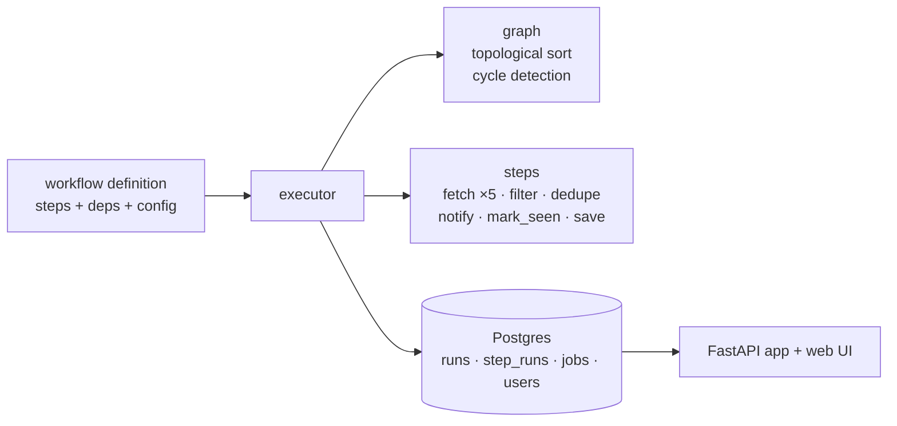

# ⚙️ Workflow Engine

> Define steps and dependencies. The engine orders them, runs them, retries failures, and remembers every run.


-336791)

A small DAG-based workflow engine built from scratch in Python, in the spirit of n8n and Airflow, plus a real workflow running on it: a job collector that pulls postings from five sources every 6 hours, alerts me on Telegram, and feeds a multi-user web app for searching and tracking jobs.

**Live:** https://workflow-engine-cp30.onrender.com (free tier, so the first load after idle takes about a minute)*

## How it works



A workflow is a plain dictionary. Each step names its function, its dependencies, and its config:

```python
workflow = {
    "fetch":       {"deps": [],                       "type": "fetch_jobs",     "config": {"boards": ["stripe", "anthropic"]}},
    "fetch_lever": {"deps": [],                       "type": "fetch_lever",    "config": {"boards": ["spotify"]}},
    "filter":      {"deps": ["fetch", "fetch_lever"], "type": "filter_jobs",    "config": {"keywords": ["machine learning"]}},
    "dedupe":      {"deps": ["filter"],               "type": "dedupe",         "config": {}},
    "notify":      {"deps": ["dedupe"],               "type": "telegram_alert", "config": {}},
    "mark":        {"deps": ["notify"],               "type": "mark_seen",      "config": {}},
    "save":        {"deps": ["fetch", "fetch_lever"], "type": "save_jobs",      "config": {}},
}
```

The engine does the rest:

| Capability | What it does |
|---|---|
| Topological ordering | Works out a valid run order from the dependencies, whatever order they were declared in |
| Cycle detection | Rejects impossible workflows (A needs B needs A) before anything runs |
| Retry with backoff | Retries a failed step up to 3 times, waiting 1s, 2s, 4s |
| Run history | Logs every run and step (status, output) to Postgres |
| Step registry | A new step type is one registered function; the engine is unchanged |

## The job workflow

Five sources feed one pipeline: **Greenhouse, Lever and Ashby** company boards plus **The Muse** and **Remotive** feeds (about 5,000 postings per run). Matching jobs (keyword, level, location) go to Telegram, and only jobs actually sent are marked as seen. Every posting is also saved to the `jobs` table, with new ones added, known ones refreshed, and vanished ones marked closed.

It runs on a GitHub Actions cron against a hosted Neon database, so it works with the laptop closed.

## Web app

Signup and login (bcrypt-hashed passwords, signed session cookies), a dashboard, search with whole-word keywords, an entry-level toggle, remote, time, company and source filters, per-user saved/applied/ignored tracking, and a run-history page.

## Design decisions

- **Mark as seen only after a successful send, and only what was sent.** A failed send means a duplicate alert next run, never a lost job (at-least-once delivery).
- **Store everything, filter at read time.** The collector saves every posting, and each user's filters are queries over the shared table.
- **Close jobs only when the source is complete.** The Muse and Remotive return partial slices, so a job missing from them proves nothing.
- **Short-lived database sessions.** Neon closes idle connections, so each write opens a session, commits, and closes. Pool pre-ping covers the rest.
- **Tests never touch real data.** The suite refuses to start unless it points at a separate database.
- **GitHub Actions cron over a scheduler service.** Free, no server to run, and a few minutes of timing jitter doesn't matter here.
- **Background runs from the API.** `POST .../run` returns `202` immediately, so callers aren't left waiting on a long request.

## API

| Endpoint | Purpose |
|---|---|
| `POST /signup`, `/login`, `/logout`, `GET /me` | Accounts |
| `GET /jobs` | Search and filter stored jobs |
| `PUT /jobs/{id}/status` | Set your status on a job |
| `GET /stats` | Dashboard numbers |
| `GET /runs`, `/runs/{run_id}`, `/workflows` | Run history |
| `POST /workflows/job_alert/run` | Start a run in the background (API key) |

All endpoints except signup and login need a logged-in session.

## Run locally

```bash
pip install -r requirements.txt
# .env needs: DATABASE_URL, SECRET_KEY, API_KEY, TELEGRAM_BOT_TOKEN, TELEGRAM_CHAT_ID
# for tests also: TEST_DATABASE_URL (a separate database)
python run_job_alert.py          # run the workflow once
uvicorn api.main:app --reload    # start the web app (API docs at /docs)
pytest                           # run the tests
```

## Testing and CI

46 pytest tests cover the engine, auth, search filters, per-user status privacy, and the saving and closing logic, including regression tests for the bugs below. GitHub Actions runs the suite on every push against a throwaway Postgres.

## Limitations and roadmap

- LinkedIn, Naukri, Internshala and Unstop have no public API, so they are not sources.
- "Remote" depends on how each source writes locations; Greenhouse boards report office cities only.
- Planned: Adzuna (India) as a source, saved filter tabs, Docker packaging.
- The engine runs steps sequentially; independent steps (the five fetches) could run in parallel.
