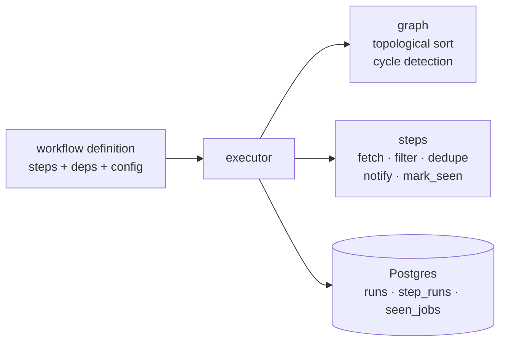

# ⚙️ Workflow Engine

> Define steps and dependencies. The engine orders them, runs them, retries failures, and remembers every run.


-336791)

A small DAG-based workflow engine built from scratch in Python, in the spirit of n8n and Airflow, plus a real workflow running on it: a job alerter that checks company career boards every 6 hours and sends new matches to Telegram.

## Demo


## How it works



A workflow is a plain dictionary. Each step names its function, its dependencies, and its config:

```python
workflow = {
    "fetch":  {"deps": [],         "type": "fetch_jobs",     "config": {"boards": ["stripe", "airbnb"]}},
    "filter": {"deps": ["fetch"],  "type": "filter_jobs",    "config": {"keywords": ["machine learning"]}},
    "dedupe": {"deps": ["filter"], "type": "dedupe",         "config": {}},
    "notify": {"deps": ["dedupe"], "type": "telegram_alert", "config": {}},
    "mark":   {"deps": ["notify"], "type": "mark_seen",      "config": {}},
}
```

The engine does the rest:

| Capability | What it does |
|---|---|
| **Topological ordering** | Works out a valid run order from the dependencies, whatever order they were declared in |
| **Cycle detection** | Rejects impossible workflows (A needs B needs A) before anything runs |
| **Retry with backoff** | Retries a failed step up to 3 times, waiting 1s, 2s, 4s between attempts |
| **Run history** | Every run and every step (status, output) is logged to Postgres |
| **Step registry** | Adding a new step type means registering one function; the engine is unchanged |

## The job-alert workflow

`fetch` (2,400+ postings across 5 Greenhouse boards) → `filter` (keyword, seniority, location) → `dedupe` (skip jobs already seen) → `notify` (Telegram) → `mark_seen` (record only what was actually sent).

It runs on a GitHub Actions cron against a hosted Neon database, so it works with the laptop closed.

## Design decisions

- **Mark as seen only after a successful send, and only what was sent.** A failed send means a duplicate alert next run, never a lost job (at-least-once delivery).
- **Short-lived database sessions.** Neon closes idle connections, so each write opens a session, commits, and closes. Pool pre-ping covers the rest.
- **GitHub Actions cron over a scheduler service.** Free, no server to run, and a few minutes of timing jitter doesn't matter for job alerts. A concurrency group prevents overlapping runs.
- **Background runs from the API.** `POST .../run` returns `202` immediately and the run continues in the background, so callers aren't left waiting on a 30-second request.

## API

FastAPI, with an API key sent in the `x-api-key` header.

| Endpoint | Purpose |
|---|---|
| `GET /health` | Liveness check (no key needed) |
| `GET /workflows` | List workflows and their steps |
| `POST /workflows/job_alert/run` | Start a run (returns 202) |
| `GET /runs` | Recent runs |
| `GET /runs/{run_id}` | Step-level detail for one run |

```bash
curl -H "x-api-key: $API_KEY" http://127.0.0.1:8000/runs
```

## Run locally

```bash
pip install -r requirements.txt
# .env needs: DATABASE_URL, TELEGRAM_BOT_TOKEN, TELEGRAM_CHAT_ID, API_KEY
python run_job_alert.py          # run the workflow once
uvicorn api.main:app --reload    # start the API (docs at /docs)
pytest                           # run the tests
```

## Testing and CI

pytest covers the steps (including a regression test for the data-loss bug below) and the API's auth. GitHub Actions runs the suite on every push against a throwaway Postgres, so nothing touches production data.

## Bugs found and fixed

| Bug | Cause | Fix |
|---|---|---|
| Jobs lost without ever being sent | `mark_seen` marked every deduped job, but the alert sent only the first 10 | Alert returns the jobs it sent; only those are marked. Regression test added |
| Crash on larger job boards | Job IDs exceeded Postgres `INTEGER` | Migrated the column to `BIGINT` |
| Real error hidden by a second error | Idle connection dropped, then the error handler reused the broken session | Short-lived sessions, connection pre-ping, rollback-safe logging |

## Limitations and roadmap

- Fetches from Greenhouse boards only; company boards are set in config.
- Planned: Lever and Ashby sources, a web dashboard for run history, Docker packaging.
- The engine runs steps sequentially; independent steps could run in parallel.