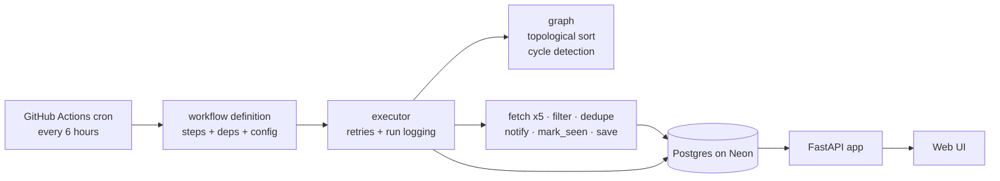

# ⚙️ Workflow Engine

> A DAG-based workflow engine built from scratch in Python, running a job-collection pipeline that feeds a multi-user web app.


-336791)


**Live demo:  https://workflow-engine-cp30.onrender.com (free tier: the first load after idle takes about a minute)*

## Overview

Tools like n8n and Airflow let you describe work as steps with dependencies. This project builds that core from scratch: an engine that validates a dependency graph, runs the steps in a valid order with retries, and logs every run. A real workflow runs on it: every 6 hours it collects job postings from five sources, alerts on new matches through Telegram, and stores everything in Postgres. A multi-user web app on top lets people search the collected jobs and track their own applications.

## Tech stack

| Layer | Technology |
|---|---|
| Language | Python 3.11 |
| Engine | Custom: topological sort, cycle detection, retry with exponential backoff |
| Database | PostgreSQL on Neon, accessed with SQLAlchemy and psycopg 3 |
| Web API | FastAPI, Uvicorn, Pydantic |
| Auth | bcrypt password hashes, signed session cookies (Starlette SessionMiddleware, itsdangerous) |
| Frontend | HTML, Tailwind CSS (CDN), vanilla JavaScript, served by FastAPI |
| Scheduling | GitHub Actions cron (every 6 hours) |
| Notifications | Telegram Bot API |
| Data sources | Greenhouse, Lever and Ashby board APIs; The Muse and Remotive feeds |
| Testing and CI | pytest, FastAPI TestClient, GitHub Actions with a throwaway Postgres service |
| Hosting | Render (web app), Neon (database) |

## Architecture



```
engine/
  graph.py      topological sort + cycle detection
  executor.py   runs steps in order; retries; logs runs and steps
  db.py         SQLAlchemy models and engine setup
  steps.py      filter, dedupe, alert, mark_seen, save, Greenhouse fetch
  sources.py    Lever, Ashby, The Muse, Remotive fetchers
api/
  main.py       endpoints and page routes
  auth.py       password hashing
  static/       the pages
  assets/       shared navigation bar
run_job_alert.py   workflow definition and entry point
tests/             pytest suite
.github/workflows/ cron job and CI
```

## How the engine works

A workflow is a plain dictionary. Each step names its function, its dependencies, and its config:

```python
workflow = {
    "fetch":       {"deps": [],                       "type": "fetch_jobs",     "config": {"boards": ["stripe", "anthropic"]}},
    "fetch_lever": {"deps": [],                       "type": "fetch_lever",    "config": {"boards": ["spotify"]}},
    "filter":      {"deps": ["fetch", "fetch_lever"], "type": "filter_jobs",    "config": {"keywords": ["machine learning"]}},
    "dedupe":      {"deps": ["filter"],               "type": "dedupe",         "config": {}},
    "notify":      {"deps": ["dedupe"],               "type": "telegram_alert", "config": {}},
    "mark":        {"deps": ["notify"],               "type": "mark_seen",      "config": {}},
    "save":        {"deps": ["fetch", "fetch_lever"], "type": "save_jobs",      "config": {}},
}
```

1. `graph.py` runs a topological sort over the dependencies and rejects cycles before anything executes.
2. `executor.py` walks the steps in that order. For each step it looks up the function in a registry by its `type`, builds the inputs from the outputs of its dependencies, and calls it through `run_with_retry`.
3. A failed step is retried up to 3 times, waiting 1s, 2s, then 4s.
4. Every run and every step (status and output) is written to Postgres, using short-lived sessions, so nothing is lost when the process exits.

Adding a new capability means writing one function and registering it. The engine itself doesn't change.

## The job-collection workflow

- **Fetch:** five independent steps pull postings from Greenhouse, Lever, Ashby, The Muse, and Remotive, about 5,000 postings per run. One source failing never stops the others.
- **Filter:** keeps jobs matching keyword, seniority, and location rules, using whole-word matching, so "Internal" no longer matches "intern".
- **Dedupe, notify, mark seen:** drops jobs already alerted on, sends new ones to Telegram (capped at 10 per message), and records only the jobs actually sent.
- **Save:** mirrors every fetched posting into the `jobs` table. New postings are added, known ones get a fresh `last_seen`, and postings missing from a complete company board are marked closed. Nothing is deleted.

## Data model

| Table | Purpose |
|---|---|
| `jobs` | Every collected posting, with source, level, first and last seen, and open or closed state |
| `seen_jobs` | IDs already alerted on, so a job is never sent twice |
| `runs`, `step_runs` | Run history and per-step status and output |
| `users` | Email and bcrypt password hash |
| `user_jobs` | Each user's own status (saved, applied, ignored) per job |

## Web app

- **Accounts:** signup and login with salted bcrypt hashes. Login sets a signed session cookie that holds only the user ID.
- **Search:** whole-word keyword matching in Postgres, entry-level toggle, remote, time range, company and source filters, and 25-per-page pagination.
- **Tracking:** mark jobs saved, applied, or ignored. Statuses are private to each user, and the user ID always comes from the session, never from the request.
- **Dashboard:** open jobs, new in the last 24 hours, personal counts, and when data was last refreshed.
- **Activity:** every workflow run with step-level detail.

## API

| Endpoint | Purpose |
|---|---|
| `POST /signup`, `/login`, `/logout`, `GET /me` | Accounts |
| `GET /jobs` | Search and filter stored jobs |
| `PUT /jobs/{id}/status` | Set your status on a job |
| `GET /stats` | Dashboard numbers |
| `GET /runs`, `/runs/{run_id}`, `/workflows` | Run history |
| `POST /workflows/job_alert/run` | Start a run in the background (returns 202; API key required) |

All endpoints except signup and login need a logged-in session.

## Design decisions

- **Mark as seen only after a successful send, and only what was sent.** A failed send means a duplicate alert, never a lost job (at-least-once delivery).
- **Store everything, filter at read time.** The collector saves every posting, and each user's filters are queries over the shared table, so a later search can find jobs an early filter would have discarded.
- **Close jobs only when the source is complete.** The Muse and Remotive return partial slices, so a job missing from them proves nothing. A board that fails to load never closes its jobs.
- **Stable IDs across sources.** Each source's ID is hashed with its name into one BIGINT, so IDs from different sources can't collide.
- **Short-lived database sessions and pool pre-ping.** Neon closes idle connections, so each write opens a session, commits, and closes.
- **Background runs from the API.** `POST .../run` returns 202 immediately, so callers aren't left waiting on a long request.
- **GitHub Actions cron over a scheduler service.** Free, no server to run, and a few minutes of jitter doesn't matter here. A concurrency group prevents overlapping runs.
- **Tests never touch real data.** The suite refuses to start unless it points at a separate database.

## Run locally

```bash
pip install -r requirements.txt
# .env needs: DATABASE_URL, SECRET_KEY, API_KEY, TELEGRAM_BOT_TOKEN, TELEGRAM_CHAT_ID
# for tests also: TEST_DATABASE_URL (a separate database)
python run_job_alert.py          # run the workflow once
uvicorn api.main:app --reload    # start the web app (API docs at /docs)
pytest                           # run the tests

## Limitations and roadmap

- LinkedIn, Naukri, Internshala, and Unstop have no public API, so they are not sources.
- "Remote" depends on how each source writes locations; Greenhouse boards report office cities only.
- The engine retries every error, including permanent ones; retrying only transient failures is a known improvement.
- Steps run sequentially; the five fetches are independent and could run in parallel.
- Planned: Adzuna (India) as a source, saved filter tabs, and Docker packaging.

Job data comes from public company boards and the feeds above. Remotive listings link back to Remotive.
